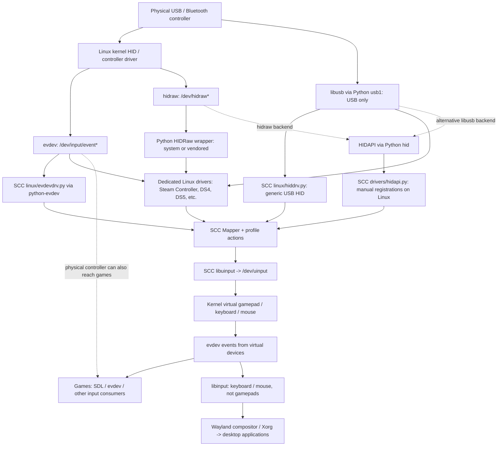
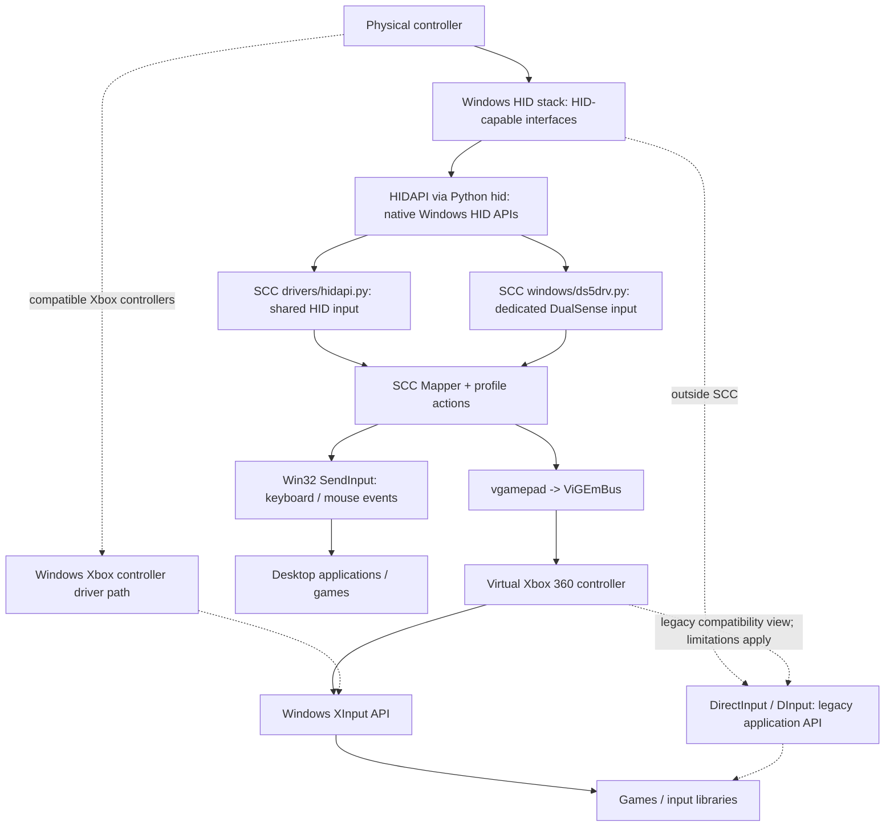
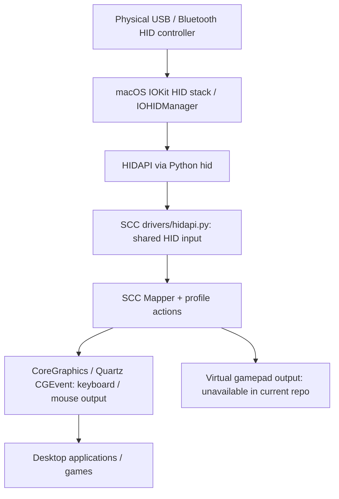

# Input and output architecture

These Mermaid diagrams describe the current repository, rather than every API available on each OS.

Arrows follow input data from hardware through SC Controller (SCC) to applications.

Dashed arrows show related OS/application paths outside SCC or implementation alternatives.

Feedback such as rumble and LEDs is omitted; support depends on the driver.
Generic HIDAPI opens only explicitly registered controllers on every OS. The SDL
database supplies initial mappings during registration; it does not authorize
opening a device. Enabled dedicated drivers discover their supported controllers.

## Linux

- `hiddrv` uses libusb directly, claims the USB HID interface and detaches its
  kernel driver. Its kernel evdev/hidraw paths are therefore not simultaneously
  available for that claimed interface.
- HIDAPI's Linux backend depends on how the library/binding was built. The
  hidraw backend supports USB and Bluetooth and leaves the kernel driver
  attached; the libusb backend supports USB only. Both arrows above are
  alternatives, not successive layers.
- Dedicated drivers choose device-specific transports. For example, DS4/DS5
  have USB, evdev and Bluetooth hidraw paths; Steam Controller Bluetooth uses
  hidraw. The `HIDRaw` wrapper used here is separate from HIDAPI.
- Keeping the physical evdev device active can let a game see both physical and
  virtual controllers unless physical input is suppressed separately.
- `libinput` is not an SCC controller backend. It processes desktop input from
  devices such as keyboards and mice, including SCC's virtual ones; it does not
  handle gamepads.

## Windows

- Windows `hidapi.py` uses HIDAPI; Linux's `hiddrv.py` uses direct libusb
  transport. SCC has no XInput or DirectInput controller input backend here.
- XInput and DirectInput are application-facing Windows APIs, not layers that
  HIDAPI must pass through. A controller exposing only an Xbox/XInput interface
  is not automatically available to SCC's generic HID backend.
- SCC creates an Xbox 360 output controller through `vgamepad` and ViGEmBus.
  Games can read it through XInput; the legacy DirectInput view has the
  compatibility limitations documented by Microsoft.

## macOS

The shared implementation lives in `scc/drivers/hidapi.py`; HIDAPI selects the
native implementation on each OS. The driver loader
loads shared modules plus the current OS's driver directory, so Windows's
dedicated `ds5drv.py` is not automatically loaded on macOS. These diagrams do not
imply full feature parity across operating systems.

## Names and layers

| Name | What it is | Relationship to SCC |
| --- | --- | --- |
| HID | Device/report protocol family | Describes controller reports; not a single library or API |
| HIDAPI / Python `hid` | Cross-platform HID report access library / Python binding | Generic input on Windows/macOS, optional on Linux; also Windows DualSense transport |
| Linux `hiddrv` | SCC's generic USB HID driver | Direct libusb transport, Python descriptor parsing, SCC's C report decoder |
| `libhiddrv` | SCC's own C report decoder in `scc/drivers/hiddrv.c` | Used by Linux USB HID drivers; not an external transport library; generic HIDAPI input uses the Python parser |
| libusb / Python `usb1` | USB access library / Python binding | Direct USB transport for Linux `hiddrv` and other USB drivers |
| hidraw / Python `HIDRaw` | Linux raw HID device interface / separate wrapper | Raw reports for dedicated drivers; hidraw is also a possible HIDAPI backend |
| evdev / python-evdev / `evdevdrv` | Linux event interface / binding / SCC driver | Kernel-decoded controller events into SCC |
| uinput / `libuinput` | Linux virtual input interface / SCC's native helper | Creates SCC's virtual output devices |
| libinput | Linux desktop input processing library | Outside SCC's controller input path; consumes keyboard/mouse events for desktops |
| XInput | Microsoft's Xbox controller API | Games can use it to read SCC's Windows virtual Xbox output |
| DirectInput / DInput | Microsoft's older input API | Outside SCC's input backends; games may use it for compatible devices |
| X11 XInput / `xinput` | X server input extension / configuration tool | Unrelated to Microsoft XInput; SCC uses the tool to detach its virtual gamepad from the X pointer master when configured |
| ViGEmBus / vgamepad | Windows virtual controller driver / Python interface | SCC's Windows virtual gamepad output |
| IOHIDManager | Native macOS HID access API | Used underneath HIDAPI |
| Quartz / CoreGraphics CGEvent | macOS event synthesis API | SCC keyboard and mouse output |

## Source references

Repository implementation:

- [Platform driver loading](scc/sccdaemon.py), [driver initialization order](scc/drivers/__init__.py)
- [Linux generic HID](scc/drivers/linux/hiddrv.py), [USB transport](scc/drivers/usb.py), [evdev](scc/drivers/linux/evdevdrv.py), [optional Linux HIDAPI](scc/drivers/hidapi.py)
- [Shared generic HIDAPI implementation](scc/drivers/hidapi.py), [Windows DualSense](scc/drivers/windows/ds5drv.py)
- [Mapper and output selection](scc/mapper.py), [Linux output](scc/uinput.py), [Windows output](scc/windows_input.py), [macOS output](scc/macos_input.py)
- [HID report decoder](scc/drivers/hiddrv.c), [registered HID report parsing](scc/lib/hid_registration.py), [X11 xinput helper](scc/lib/xinput.py)

External API documentation:

- [HIDAPI platforms and Linux backend alternatives](https://github.com/libusb/hidapi/blob/master/README.md)
- [Linux hidraw interface](https://www.kernel.org/doc/html/latest/hid/hidraw.html)
- [libinput scope and why gamepads are excluded](https://wayland.freedesktop.org/libinput/doc/latest/what-is-libinput.html)
- [Microsoft XInput and DirectInput comparison](https://learn.microsoft.com/en-us/windows/win32/xinput/xinput-and-directinput)
